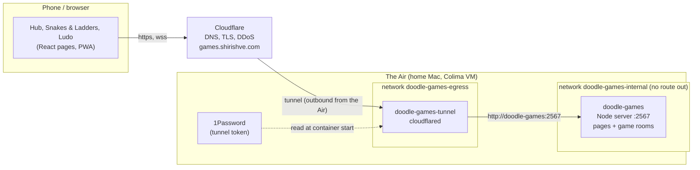
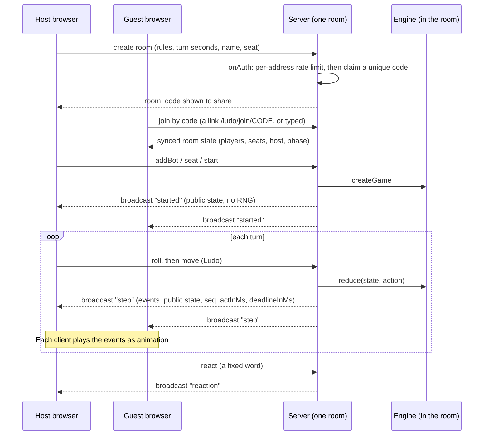

# Doodle Games architecture

Doodle Games is a set of board games drawn like crayon doodles. A hub page lists the games.
Each game runs in the browser for one-device play, and online by room code.
One Node process serves every page and every game room. It runs in a container on a home Mac.
GitHub draws the diagrams below (Mermaid). When the architecture changes, update this file in the same commit.

## What runs where



- One process serves everything on port 2567: the hub at `/`, Snakes & Ladders at `/snakes/`, Ludo at `/ludo/`,
  both games' rooms over WebSocket, and `GET /__healthcheck`. There is no database and no account system.
  Rooms live in memory. A restart ends the games in progress and loses nothing else.
- The public name is `https://games.shirishve.com`. It is a proxied DNS record that points at a Cloudflare Tunnel.
  The tunnel connects outbound from the Air, so no router port is open. Its one route sends the name to
  `http://doodle-games:2567`. Any other name gets a 404.
- The game container is only on an internal Docker network. It has no published port and no route to the Mac,
  the LAN or the internet. Only the tunnel container can reach it.
  A rule in the Colima VM also drops traffic from that network to the VM itself.
- Both containers run non-root, with a read-only filesystem, no capabilities, and memory and process limits.
- The tunnel token is kept in 1Password and read when the container starts. It is not written to disk.
  [`deploy/air/cloudflare-tunnel.sh`](../deploy/air/cloudflare-tunnel.sh) creates or re-checks the tunnel, route and DNS record.
- The image is built from the [`Dockerfile`](../Dockerfile): it builds every web client, bundles the server, and copies
  the clients into `/app/clients/{hub,snakes,ludo}`. The commit id is passed as `BUILD_ID` and shown small on each page.
- Details and the deploy steps: [HOSTING.md](HOSTING.md).
- Outside services: Cloudflare (DNS, tunnel, TLS) and 1Password (the token). Fonts are files in the repo. CI is GitHub Actions ([ci.yml](../.github/workflows/ci.yml)): lint, test, build, e2e.
  The code does not show how the Air gets a new version; HOSTING.md describes a manual `git pull`, build and run.

## Main paths

### Load the hub and open a game

```mermaid
sequenceDiagram
  participant B as Browser
  participant C as Cloudflare
  participant S as Node server :2567
  B->>C: GET games.shirishve.com/
  C->>S: through the tunnel
  S-->>B: hub index.html + hashed assets (served from clients/hub)
  Note over B: The hub shows one card per game
  B->>S: GET /ludo/ (a card link)
  S-->>B: Ludo index.html; /ludo/assets/* cached for a year, everything else no-cache
  B->>S: GET /ludo/sw.js
  Note over B: Each game's service worker caches its own shell for offline play
```

- `serveStatic` answers a page path with no file extension (for example `/ludo/join/ABC123`) with that game's `index.html`.
  A missing file with an extension is a 404, never the app. iOS probes for icons, and an HTML answer left a blank icon.
- Old Snakes & Ladders share links (`/join/CODE`) redirect to `/snakes/join/CODE`. `/sw.js` at the root retires the old
  offline worker that lived there before the hub existed.
- The hub itself has no service worker and no game logic.

### Play on one device

The game's rules live in a pure `engine` package (no DOM, timers, randomness or IO; the seeded RNG is inside the state).
The web app imports the engine and calls `createGame` and `reduce` in the browser, so one-device play with bots needs no
server after the page has loaded. The service worker keeps the page working offline.

### Play online (Colyseus rooms over WebSocket)

The server uses Colyseus. Snakes & Ladders defines the room type `game` and Ludo defines `ludo`, both on the same server.
Room codes are 6 characters from an alphabet without look-alikes, and one code set covers both games.



- The server owns the game. A client sends only actions. The server runs the engine, checks who may act and when, then
  broadcasts the new public state. The RNG and the log are removed first, so a client cannot read future rolls.
- A bot acts after a short pause. A disconnected player is played for after a short pause (`awayActMs`).
  A disconnected player has 120 seconds to come back (`allowReconnection`). Each turn has a deadline (`turnDeadline`);
  what happens at the deadline was not checked for this document.
- A browser tab keeps its reconnection token in `sessionStorage`, so a refresh returns to the same seat.
  If storage is blocked, a refresh leaves the room.
- Reactions are a fixed set of words, not free chat. The server relays them and stores nothing.
- Abuse limits (shared by both games): 30 creates or joins per address per minute (read from `CF-Connecting-IP`),
  200 open rooms, 20 messages per client per second. A room with nobody in it closes after 60 seconds.
- In production the page and the WebSocket use the same origin (`location.origin`). In local development the Vite server
  runs beside a game server on another port (Snakes & Ladders 2567, Ludo 2568).
- The Snakes & Ladders room code was not read for this document beyond its room name and the shared helpers.
  The Ludo room (`LudoRoom.ts`) is the one the sequence above follows. Snakes & Ladders uses the same shared helpers and
  the same message style (`started`, `reaction`, turn messages), but its exact message names were not checked here.

## Local development and tests

| Command | Runs |
|---|---|
| `pnpm dev` | Snakes & Ladders web app, Vite, `:5173` |
| `pnpm dev:ludo` | Ludo web app, Vite, `:5176` (local play) |
| `pnpm dev:ludo-server` | Ludo server with its page, `:2568` (build the web app first) |
| `pnpm start` | The production server after `pnpm build`: hub and both games on `:2567` |
| `pnpm test`, `pnpm lint`, `pnpm build` | Turborepo, every package in every game |
| `pnpm e2e` | Playwright against the production server ([playwright.config.ts](../playwright.config.ts)) |

`TIMING_SCALE` (a number below 1) shortens intros, playback and bot pauses in the server. End-to-end tests use it.

## Code map

A pnpm workspace with Turborepo ([pnpm-workspace.yaml](../pnpm-workspace.yaml), [turbo.json](../turbo.json)).
Each game keeps its own `apps/` and `packages/`. The root `packages/` holds what games share.

### Shared and site level

| Path | Owns |
|---|---|
| [apps/hub](../apps/hub) | The page at `/`: one card per game ([Hub.tsx](../apps/hub/src/Hub.tsx)), manifest and icons, the worker that retires the old root worker ([sw.js](../apps/hub/public/sw.js)) |
| [apps/server](../apps/server) | The production server. [app.ts](../apps/server/src/app.ts) mounts redirects, the static clients and both games' rooms. [index.ts](../apps/server/src/index.ts) reads `PORT`, `HOST`, `CLIENTS_DIR`, `TIMING_SCALE`. Test: [site.test.ts](../apps/server/test/site.test.ts) |
| [packages/doodle-rooms](../packages/doodle-rooms) | What online rooms share. [index.ts](../packages/doodle-rooms/src/index.ts) (browser-safe): code alphabet, seats, names, timings, reactions. [server.ts](../packages/doodle-rooms/src/server.ts): unique room codes, rate limits, room cap, name cleaning, JSON logging. [static.ts](../packages/doodle-rooms/src/static.ts): static file serving and redirects |
| [packages/ui-doodle](../packages/ui-doodle) | Shared drawing: characters and tokens, dice and dice tower, paper slips, margin doodles, crayon filters ([PencilDefs.tsx](../packages/ui-doodle/src/PencilDefs.tsx)), `startBlinking` |
| [packages/doodle-sound](../packages/doodle-sound) | Synthesised sound effects ([index.ts](../packages/doodle-sound/src/index.ts)) |
| [docs/reference](reference) | The doodle style frames every game follows |
| [deploy/air](../deploy/air) | [run-containers.sh](../deploy/air/run-containers.sh) (networks and containers), [cloudflare-tunnel.sh](../deploy/air/cloudflare-tunnel.sh) (tunnel, route, DNS), [colima-provision.yaml](../deploy/air/colima-provision.yaml) (VM firewall rules) |
| [Dockerfile](../Dockerfile) | One image with every game |
| [e2e](../e2e) | Root end-to-end test of the hub ([hub.spec.ts](../e2e/hub.spec.ts)) |

### Games

| Game (path) | Package | Owns |
|---|---|---|
| Snakes & Ladders (`/snakes/`), [folder](../games/snakes-and-ladders), [its CLAUDE.md](../games/snakes-and-ladders/CLAUDE.md) | [packages/engine](../games/snakes-and-ladders/packages/engine) | Pure rules, seeded RNG, board validation, simulation |
| | [packages/boards](../games/snakes-and-ladders/packages/boards) | Board schema, geometry and the ten built-in boards (JSON) |
| | [packages/protocol](../games/snakes-and-ladders/packages/protocol) | Room name (`game`) and message types shared by client and server |
| | [apps/server](../games/snakes-and-ladders/apps/server) | `GameRoom` (the Colyseus room) and its own standalone server entry |
| | [apps/web](../games/snakes-and-ladders/apps/web) | React app (Vite, base `/snakes/`): board art, store, online client ([net/online.ts](../games/snakes-and-ladders/apps/web/src/net/online.ts)), printable boards ([print](../games/snakes-and-ladders/apps/web/src/print)), service worker |
| Ludo (`/ludo/`), [folder](../games/ludo), [plan](../games/ludo/docs/PLAN.md) | [packages/engine](../games/ludo/packages/engine) | Pure rules (Ludo King), bot, seeded RNG |
| | [packages/protocol](../games/ludo/packages/protocol) | Room name (`ludo`), message types, pacing ([pace.ts](../games/ludo/packages/protocol/src/pace.ts)) |
| | [apps/server](../games/ludo/apps/server) | [LudoRoom.ts](../games/ludo/apps/server/src/rooms/LudoRoom.ts) (lobby, turns, bots, timers, reconnect), [schema.ts](../games/ludo/apps/server/src/schema.ts) (synced state), standalone server entry |
| | [apps/web](../games/ludo/apps/web) | React app (Vite, base `/ludo/`): board, tokens, store, online client ([net/online.ts](../games/ludo/apps/web/src/net/online.ts)), service worker |

Each game also has its own `e2e/` folder. Snakes & Ladders also has [scripts/check-engine-purity.mjs](../games/snakes-and-ladders/scripts/check-engine-purity.mjs),
which `pnpm lint` runs on both engines.

### Adding a game

From [CLAUDE.md](../CLAUDE.md): build the web app with Vite `base: "/<game>/"`, mount it in `apps/server`, and add a card in `apps/hub`.
The Dockerfile also lists each game's `package.json` and copies each game's built client, so a new game needs lines there too.
